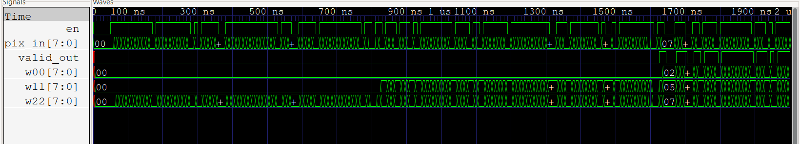

# Streaming 3×3 Image Filter in Verilog

A fully pipelined, multiplier-free Verilog design that filters an 8-bit grayscale image at one pixel per clock. It supports **Gaussian blur** and **Sobel edge detection**, and is verified bit-exact against a Python golden model with Icarus Verilog.


## Overview

- Streaming architecture: no frame buffer, only two line buffers
- One pixel in and one result out per clock once the pipeline is full
- Two modes, selected by `mode` (0 = Gaussian, 1 = Sobel)
- No multipliers: every kernel coefficient is 1, 2, or 4, so each product is a shift
- Self-checking testbenches, plus a byte-for-byte comparison against a Python model
- Simulation-only; the design is parameterized by image width and height

## Architecture

```
                  ┌─────────────────────── window_3x3 ───────────────────────┐
pix_in ──┬────────┤ w22 w21 w20   (newest row)                                │
         │        │                                                           │
         └► line_buffer ─┬──────┤ w12 w11 w10                                 │──► conv3x3 ──► top_filter output
                         │      │                                             │   (2 stages)   (round / |Gx|+|Gy| / clamp)
                         └► line_buffer ─► w02 w01 w00   (oldest row)         │
                  └───────────────────────────────────────────────────────────┘
```

| Module | Role |
|---|---|
| `line_buffer.v` | One-row delay (`W` samples) built from a small RAM and a wrapping pointer |
| `window_3x3.v` | Chains two line buffers, holds the 3×3 shift-register window, tracks row/column, and generates `valid` |
| `conv3x3.v` | Two-stage pipelined datapath that computes the Gaussian sum, Sobel Gx, and Sobel Gy in parallel |
| `sobel_mag.v` | Gradient magnitude approximation `abs(Gx) + abs(Gy)` |
| `saturate.v` | Clamp to 0..255 |
| `top_filter.v` | Wires everything together; final rounding or magnitude, mode select, output register |

### Pipeline

| Stage | Location | Work done |
|---|---|---|
| 1 | `window_3x3` | Window registered, `valid` computed |
| 2 | `conv3x3` stage 1 | Row sums (Gaussian) and row/column differences (Sobel) |
| 3 | `conv3x3` stage 2 | Combine into `gsum` (12 b), `gx` and `gy` (11 b signed) |
| 4 | `top_filter` | Gaussian rounding, or Sobel magnitude and clamp, then mode select |

Latency is **4 register stages** from the last pixel of a window entering to its result appearing. `valid` and `mode` travel down the pipeline with the data, and stages 2 to 4 run without an enable, so input stalls need no extra logic and the pipeline drains on its own.

## Fixed-point specification

| Item | Decision |
|---|---|
| Image | 64×64, 8-bit grayscale (`W` and `H` are parameters) |
| Pixel order | Row-major stream |
| Border handling | Valid-only output: 62×62, no padding |
| Gaussian kernel | `[1 2 1; 2 4 2; 1 2 1]`, then `(sum + 8) >> 4` |
| Sobel Gx | `[-1 0 1; -2 0 2; -1 0 1]` |
| Sobel Gy | `[-1 -2 -1; 0 0 0; 1 2 1]` |
| Sobel magnitude | `min(255, abs(Gx) + abs(Gy))` |
| Gaussian sum width | 12 bits unsigned (max 4080); the rounded result never exceeds 255, so no clamp is needed |
| Sobel Gx/Gy width | 11 bits signed (range ±1020) |

Interface notes: `pix_out` is only meaningful when `valid_out` is high. `mode` must be held constant for the duration of a frame.

## Verification

1. **Unit tests** (`tb_line_buffer`, `tb_window`): the line buffer is checked against a delayed copy of its own input, and every 3×3 window is checked against the neighborhood read straight from the image array. Both run with random input stalls.
2. **Full-frame test** (`tb_top`): the whole image is streamed through in both modes, with and without random stalls. Outputs are checked on the fly against golden data and written to a hex file.
3. **Independent comparison**: `cmp` compares the written hex files byte for byte against the golden files, so a bug in the testbench's own checker cannot hide a mismatch. `compare.py` then reports mismatches and error metrics.

The golden model (`model/golden.py`) uses explicit per-window loops so its arithmetic mirrors the RTL's rounding and clamping exactly.

Result: **0 mismatches out of 3844 pixels** in all four configurations (Gaussian and Sobel, with and without stalls).

## Results


<!-- PASTE the contents of figures/results.md here -->

**Cost of the magnitude approximation.** The RTL is bit-exact against the golden model, so PSNR against it would be infinite and uninformative. The table above instead compares the fixed-point output against an ideal floating-point reference (Gaussian without rounding, Sobel with a true square root).


The Sobel error is always positive and concentrates on diagonal edges, where `|Gx|+|Gy|` overestimates the true magnitude by up to a factor of √2. It is near zero on axis-aligned edges.

### Waveforms




`valid_out` first rises once the oldest window row holds real image data, which is after two full rows plus three pixels. Before that, the datapath computes on partly zero windows, so `pix_out` toggles; those values are ignored because `valid_out` is low.

### Resource estimate (Yosys, `synth_xilinx`, flattened)

Pre-place-and-route estimate; no timing or Fmax is claimed. Full report: [`reports/yosys_xilinx.txt`](reports/yosys_xilinx.txt).

| Resource | Count |
|---|---|
| LUT2 / LUT3 / LUT4 / LUT5 / LUT6 | 74 / 71 / 51 / 1 / 19 (216 total) |
| Inverters | 26 |
| Flip-flops (FDRE) | 231 |
| Carry chains (CARRY4) | 56 |
| LUT RAM (RAM64M / RAM64X1S) | 3 / 8 |
| DSP blocks | 0 |
| Block RAM | 0 |

The two line buffers (2 × 64 × 8 bits) were inferred as distributed RAM. Without that inference they would cost roughly a thousand flip-flops. No DSP blocks are used, as intended from the shift-and-add design.

## How to run

Prerequisites: Icarus Verilog, GTKWave, Python 3 with `numpy`, `Pillow`, and `matplotlib`. Yosys is optional (for `make stats`).

```bash
make test      # golden model, unit tests, full-image tests, comparison and figures
make wave      # open the last waveform in GTKWave
make stats     # Yosys resource estimates
make clean
```

| Target | What it does |
|---|---|
| `make golden` | Generates the test image, golden outputs, and input/golden figures |
| `make sim_unit` | Runs the unit testbenches |
| `make sim_top` | Runs four full-image tests and `cmp` checks |
| `make compare` | Runs `compare.py` and regenerates the result figures |

## Design decisions and limitations

- **`|Gx|+|Gy|` instead of a square root.** A square root is costly in hardware; the cheaper form overestimates diagonal edges by up to √2, which the error figure quantifies.
- **Valid-only output (62×62).** Zero-padding needs border-aware muxing in the window. Dropping the border keeps the datapath simple and the test exact.
- **Shifts instead of multipliers.** All coefficients are powers of two, so no DSP blocks are needed.
- **Combinational-read line buffers.** These map to distributed RAM. Block RAM requires a synchronous read, which would add one cycle of delay to the window logic.
- **No enable in the datapath.** `valid` marks real outputs, which removes stall logic at the cost of toggling on meaningless data while the pipeline fills.
- **Single frame, fixed `mode` per frame.** There is no frame-boundary or `mode`-change handling.
- **Simulation only.** Resource figures are synthesis estimates, with no place-and-route, timing closure, or board testing.

## Future work

- Zero-padded borders so the output is the same size as the input
- Synchronous-read line buffers to target block RAM
- Bilinear image scaler or 8×8 DCT stage reusing the line-buffer approach
- VGA output stage for a board demo

## Repository layout

```
rtl/       Verilog sources
tb/        Testbenches
model/     Python golden model and comparison script
data/      Generated input and golden hex files
figures/   Result images and waveform screenshots
reports/   Committed Yosys report
```

## License

MIT (add a `LICENSE` file).
