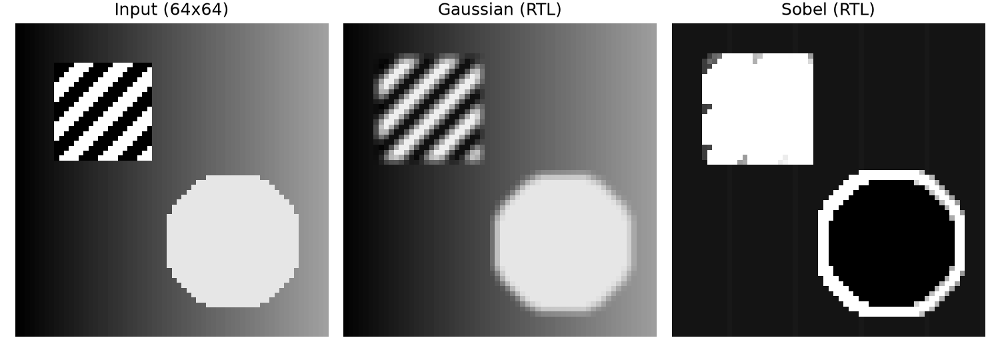
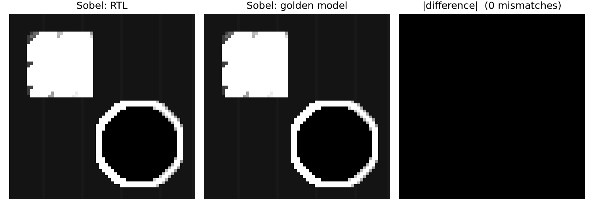
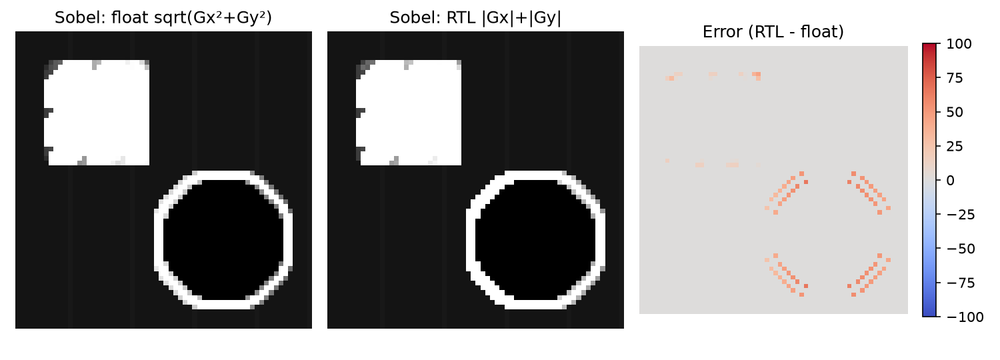
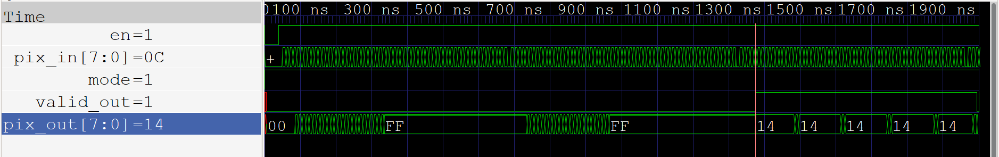

# Streaming 3×3 Sobel and Gauss 64-bit Image Filter

A fully pipelined, multiplier-free Verilog design that filters an 8-bit grayscale image at one pixel per clock. It supports **Gaussian blur** and **Sobel edge detection**, and is verified bit-exact against a Python golden model with Icarus Verilog.



## Overview

- Streaming architecture: no frame buffer, only two line buffers
- One pixel in and one result out per clock once the pipeline is full
- Two modes, selected by `mode` (0 = Gaussian, 1 = Sobel)
- No multipliers: every kernel coefficient is 1, 2, or 4, so each product is a shift
- Self-checking testbenches, plus a byte-for-byte comparison against a Python model

For hardware interface, refer to [TOP.md](docs/top.md)

## Architecture
 


Refer to [ARCHITECTURE.md](docs/architecture.md) for specifications and diagrams.
### Pipeline

| Stage | Location | Work done |
|---|---|---|
| 1 | `window_3x3` | Window registered, `valid` computed |
| 2 | `conv3x3` stage 1 | Row sums (Gaussian) and row/column differences (Sobel) |
| 3 | `conv3x3` stage 2 | Combine into `gsum` (12 b), `gx` and `gy` (11 b signed) |
| 4 | `top_filter` | Gaussian rounding, or Sobel magnitude and clamp, then mode select |

Latency is **4 register stages** from the last pixel of a window entering to its result appearing. `valid` and `mode` travel down the pipeline with the data, and stages 2 to 4 run without an enable, so input stalls need no extra logic and the pipeline drains on its own.

## Repository layout

```
├── docs/      Datapath block diagrams, verification notes.
├── rtl/       Verilog sources
├── tb/        Testbenches
├── model/     Python golden model and comparison script
├── data/      Generated input and golden hex files
├── figures/   Result images and waveform screenshots
├── Makefile    # Icarus-Verilog build and simulation
└── README.md   # Project overview
```

## Verification & Results

For testbenches refer to [VERIFICATION.md](docs/verification.md).



**Cost of the magnitude approximation.** The RTL is bit-exact against the golden model, so PSNR against it would be infinite and uninformative. The table above instead compares the fixed-point output against an ideal floating-point reference (Gaussian without rounding, Sobel with a true square root).



The Sobel error is always positive and concentrates on diagonal edges, where `|Gx|+|Gy|` overestimates the true magnitude by up to a factor of √2. It is near zero on axis-aligned edges.

### Waveforms




`valid_out` first rises once the oldest window row holds real image data, which is after two full rows plus three pixels. Before that, the datapath computes on partly zero windows, so `pix_out` toggles; those values are ignored because `valid_out` is low.

## Notes

- **`|Gx|+|Gy|` instead of a square root.** A square root is costly in hardware; the cheaper form overestimates diagonal edges by up to √2, which the error figure quantifies.
- **Valid-only output (62×62).** Zero-padding needs border-aware muxing in the window. Dropping the border keeps the datapath simple and the test exact.
- **Shifts instead of multipliers.** All coefficients are powers of two, so no DSP blocks are needed.
- **Combinational-read line buffers.** These map to distributed RAM. Block RAM requires a synchronous read, which would add one cycle of delay to the window logic.
- **No enable in the datapath.** `valid` marks real outputs, which removes stall logic at the cost of toggling on meaningless data while the pipeline fills.
- **Single frame, fixed `mode` per frame.** There is no frame-boundary or `mode`-change handling.