# Architecture

### Datapath Block Diagram for top filter

### Sub-modules

| Module | Role |
|---|---|
| `line_buffer.v` | One-row delay (`W` samples) built from a small RAM and a wrapping pointer |
| `window_3x3.v` | Chains two line buffers, holds the 3×3 shift-register window, tracks row/column, and generates `valid` |
| `conv3x3.v` | Two-stage pipelined datapath that computes the Gaussian sum, Sobel Gx, and Sobel Gy in parallel |
| `sobel_mag.v` | Gradient magnitude approximation `abs(Gx) + abs(Gy)` |
| `saturate.v` | Clamp to 0..255 |
| `top_filter.v` | Wires everything together; final rounding or magnitude, mode select, output register |

### Fixed-point specification

| Item | Decision |
|---|---|
| Image | 64×64, 8-bit grayscale (`W` and `H` are parameters) |
| Pixel order | Row-major stream |
| Border handling | Valid-only output: 62×62, no padding |
| Gaussian kernel | `[1 2 1; 2 4 2; 1 2 1]`, then `(sum + 8) >> 4` |
| Sobel Gx | `[-1 0 1; -2 0 2; -1 0 1]` |
| Sobel Gy | `[-1 -2 -1; 0 0 0; 1 2 1]` |
| Sobel magnitude | `min(255, abs(Gx) + abs(Gy))` |
| Gaussian sum width | 12 bits unsigned (max 4080); the rounded result never exceeds 255, so no clamp is needed |
| Sobel Gx/Gy width | 11 bits signed (range ±1020) |

Interface notes: `pix_out` is only meaningful when `valid_out` is high. `mode` must be held constant for the duration of a frame.

### Control Unit Diagram
